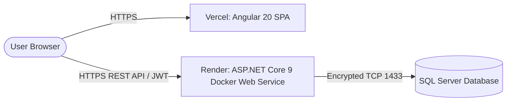

# MobileShop Deployment Guide: Vercel (Frontend) & Render (Backend)

This guide provides end-to-end instructions for deploying the **MobileShop** project to production using:
- **Frontend**: [Vercel](https://vercel.com) (Angular 20 Single Page Application)
- **Backend API**: [Render](https://render.com) (ASP.NET Core 9 Web API in Linux Docker Container)
- **Database**: Cloud SQL Server / Azure SQL / AWS RDS (or Secure Tunnel to Local SQL Server Express)

---

## Architecture Overview



---

## 1. Addressing the Database Connection String

Your local connection string:
```text
Server=.\\SQLEXPRESS;Database=MobileShopManagementDb;Trusted_Connection=True;TrustServerCertificate=True;MultipleActiveResultSets=true;
```

### Why this cannot be used directly in Cloud containers (Render):
1. **`Server=.\\SQLEXPRESS`** points to `localhost` (the local machine). In Render, the app runs inside an isolated Linux container where no local SQL Server instance is running.
2. **`Trusted_Connection=True`** uses Windows Integrated Authentication, which only functions inside a Windows domain/machine, not inside a cloud Linux container.

### Choose one of the following 2 solutions:

### Option A: Cloud SQL Database (Recommended for Production)
Provision a cloud-hosted SQL Server database such as **Azure SQL Database** (Free Tier available: 100,000 vCore-seconds per month) or **AWS RDS for SQL Server**:

1. Create an Azure SQL Database (or AWS RDS SQL Server).
2. Set Server Authentication to **SQL Server Authentication** (e.g., username `sqladmin`, password `YourStrongPassword123!`).
3. Under **Firewall and Virtual Networks**, enable **"Allow Azure services and resources to access this server"** (or whitelist `0.0.0.0/0` with strong password).
4. Run your EF Core migrations or seed script from your local machine to populate the cloud database:
   ```powershell
   cd c:\Dev\Mobile2\MobileShop.Api
   dotnet ef database update --connection "Server=tcp:your-server.database.windows.net,1433;Database=MobileShopManagementDb;User ID=sqladmin;Password=YourStrongPassword123!;Encrypt=True;TrustServerCertificate=False;MultipleActiveResultSets=true;"
   ```
5. Your production connection string for Render will look like:
   ```text
   Server=tcp:your-server.database.windows.net,1433;Database=MobileShopManagementDb;User ID=sqladmin;Password=YourStrongPassword123!;Encrypt=True;TrustServerCertificate=False;MultipleActiveResultSets=true;
   ```

---

### Option B: Expose Local `SQLEXPRESS` via Secure Tunnel (For Testing / Staging)
If you want to keep your local `.\\SQLEXPRESS` database without paying or creating a cloud database right away:

1. **Enable Mixed Mode (SQL Server and Windows Authentication)**:
   - Open SQL Server Management Studio (SSMS).
   - Right-click server instance `.\\SQLEXPRESS` -> **Properties** -> **Security** -> Select **SQL Server and Windows Authentication mode**.
   - Restart the SQL Server (SQLEXPRESS) service.
2. **Enable and set password for `sa` user**:
   - In SSMS -> **Security** -> **Logins** -> `sa` -> Right click -> **Properties**.
   - Set a strong password and under **Status**, set **Login** to **Enabled**.
3. **Enable TCP/IP in SQL Server Configuration Manager**:
   - Open **SQL Server Configuration Manager**.
   - Go to **SQL Server Network Configuration** -> **Protocols for SQLEXPRESS**.
   - Enable **TCP/IP**.
   - Right-click **TCP/IP** -> **Properties** -> **IP Addresses** tab -> Scroll to **IPAll** -> set **TCP Port** to `1433` (clear TCP Dynamic Ports).
   - Restart the SQL Server service.
4. **Expose port 1433 with ngrok**:
   ```powershell
   ngrok tcp 1433
   ```
   *ngrok will provide a forwarding address, e.g., `tcp://0.tcp.ngrok.io:12345`.*
5. **Connection String for Render**:
   ```text
   Server=tcp:0.tcp.ngrok.io,12345;Database=MobileShopManagementDb;User ID=sa;Password=YourPassword123;Encrypt=True;TrustServerCertificate=True;MultipleActiveResultSets=true;
   ```

---

## 2. Deploying Backend API to Render

The repository is already equipped with:
- [`Dockerfile`](file:///c:/Dev/Mobile2/Dockerfile) in the root directory (.NET 9 SDK + ASP.NET 9 Runtime)
- [`render.yaml`](file:///c:/Dev/Mobile2/render.yaml) blueprint configuration

### Step-by-Step Instructions:

1. **Push your code to GitHub**:
   ```bash
   git add .
   git commit -m "Configure production deployment for Render and Vercel"
   git push origin <your-branch>
   ```

2. **Log into Render**:
   - Go to [https://dashboard.render.com/](https://dashboard.render.com/).

3. **Deploy using Web Service (Manual or Blueprint)**:

   #### Method 1: Web Service (Direct)
   - Click **New +** -> **Web Service**.
   - Connect your GitHub repository.
   - Set the following settings:
     - **Name**: `mobileshop-api` (or your choice)
     - **Region**: Choose closest to you (e.g., Frankfurt or Oregon)
     - **Branch**: `antigravity-enhancement`
     - **Root Directory**: Leave **BLANK / EMPTY** (Do not type `MobileShop.Api`; Docker must run from repo root)
     - **Runtime**: **Docker** (Render will detect root `Dockerfile`)
     - **Dockerfile Path**: Leave **blank** or `./Dockerfile`
     - **Plan**: **Free**
   - Scroll down to **Environment Variables** and add:
     | Key | Recommended Value | Note |
     |---|---|---|
     | `ASPNETCORE_ENVIRONMENT` | `Production` | Runs in production mode |
     | `ConnectionStrings__DefaultConnection` | *(Your Cloud SQL Server Connection String)* | From Step 1 |
     | `Jwt__SecretKey` | `YourSuperSecretKeyWithAtLeast64CharactersLongForHmacSha256Security12345!` | Min 32 chars |
     | `Jwt__Issuer` | `MobileShopApi` | Matches JWT Issuer |
     | `Jwt__Audience` | `MobileShopWeb` | Matches JWT Audience |
     | `AllowedOrigins` | `https://your-vercel-app.vercel.app` | Your Vercel frontend URL |

   #### Method 2: Blueprint (`render.yaml`)
   - Click **New +** -> **Blueprint**.
   - Select your repository.
   - Render will read [`render.yaml`](file:///c:/Dev/Mobile2/render.yaml) and prompt you only for the secret values (`ConnectionStrings__DefaultConnection`, `Jwt__SecretKey`).

4. **Verify Deployment**:
   - Once deployment completes (usually 2-3 minutes), Render provides a URL like:
     `https://mobileshop-api.onrender.com`
   - Test endpoints:
     - Health / Products: `https://mobileshop-api.onrender.com/api/products`
     - Swagger UI: `https://mobileshop-api.onrender.com/swagger/index.html`

---

## 3. Deploying Frontend to Vercel

The Angular project is pre-configured with:
- `MobileShop.Web/vercel.json` with SPA route rewrites.
- `angular.json` with `fileReplacements` pointing `environment.ts` to `environment.production.ts`.

### Step-by-Step Instructions:

1. **Set the Backend URL in `MobileShop.Web/src/environments/environment.production.ts`**:
   Make sure it matches your Render API URL:
   ```typescript
   export const environment = {
     production: true,
     apiBaseUrl: 'https://mobileshop-api.onrender.com' // Replace with your actual Render URL
   };
   ```

2. **Log into Vercel**:
   - Go to [https://vercel.com/](https://vercel.com/).
   - Click **Add New...** -> **Project**.
   - Import your GitHub repository.

3. **Configure Project Settings**:
   - **Framework Preset**: `Angular`
   - **Root Directory**: Click `Edit` and select `MobileShop.Web`.
   - **Build and Output Settings**:
     - **Build Command**: `npm run build` (or `ng build --configuration=production`)
     - **Output Directory**: `dist/mobile-shop-web/browser` *(Important: Angular 17+ uses the browser subfolder)*
     - **Install Command**: `npm install`
   
4. **Deploy**:
   - Click **Deploy**.
   - Vercel will build the Angular application and provide a live URL, e.g., `https://mobileshop-web.vercel.app`.

---

## 4. Post-Deployment Verification Checklist

- [ ] **SPA Route Reloading**: Navigate to `https://your-vercel-app.vercel.app/mobiles` and hit browser refresh (F5). The page should reload smoothly without a 404 error (handled by `vercel.json`).
- [ ] **CORS Verification**: Open DevTools (`F12`) -> Network tab in your browser. Verify API calls to `https://mobileshop-api.onrender.com/api/...` return `200 OK` without CORS errors.
- [ ] **Content Security Policy**: Check console for any CSP violations. The CSP middleware explicitly permits connections to `*.onrender.com` and `*.vercel.app`.
- [ ] **Authentication Flow**: Log in using your admin or customer account, check that the JWT token is stored and authenticated endpoints respond with `200 OK`.
